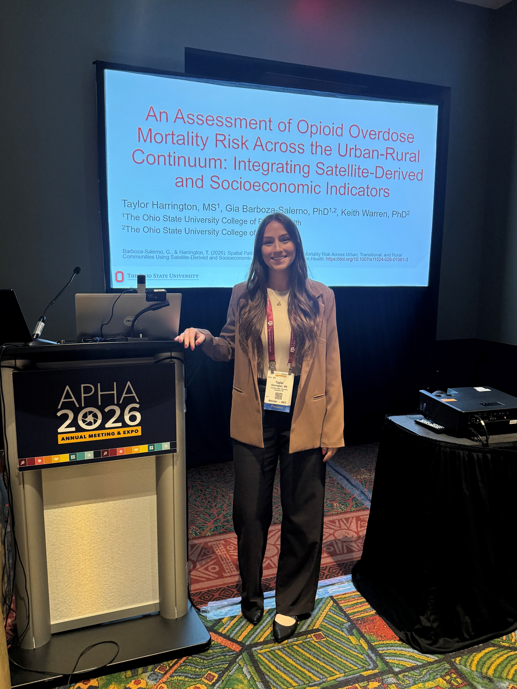
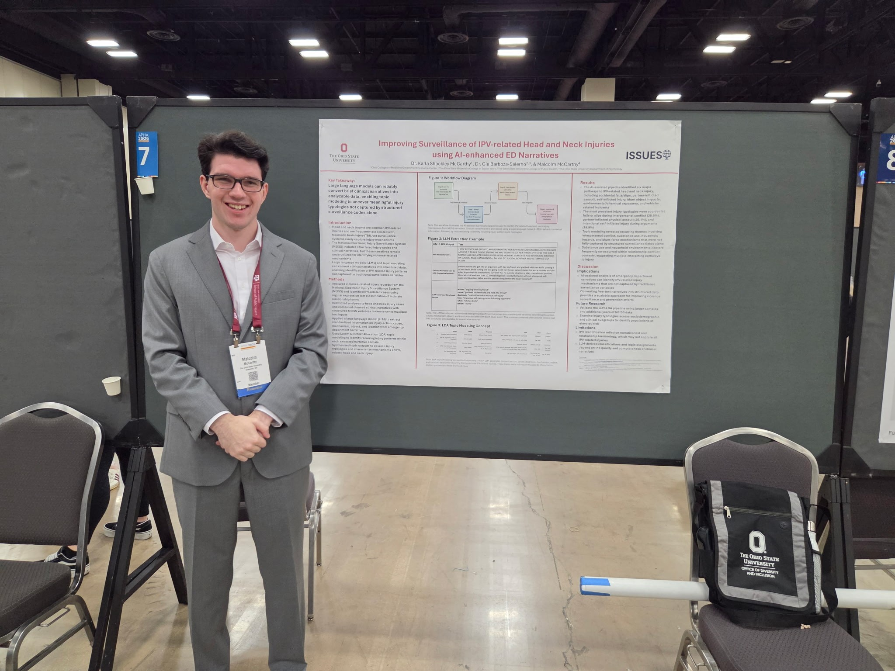

We are proud to congratulate **Taylor Harrington** and **Malcolm McCarthy** on their outstanding presentations at the **2026 American Public Health Association (APHA) Annual Meeting & Expo** in **San Antonio, Texas** (November 1–4, 2026)!

  <figure style="margin:0;">
    
    <figcaption style="text-align:center; font-size:0.9rem; color:#555; margin-top:6px;">Taylor Harrington presenting at APHA 2026 in San Antonio, TX</figcaption>
  </figure>
  <figure style="margin:0;">
    
    <figcaption style="text-align:center; font-size:0.9rem; color:#555; margin-top:6px;">Malcolm McCarthy presenting at APHA 2026 in San Antonio, TX</figcaption>
  </figure>

### Featured Presentations

- **Taylor Harrington**, *Gia Elise Barboza-Salerno, Rayna Booker, & Dr. Keith Warren*  
  [**An assessment of opioid overdose mortality risk across the urban–rural continuum: Integrating satellite-derived and socioeconomic indicators**](/event/apha-2026-presentation-6/)  
  *Session:* Built environment and community-based approaches to advancing health equity (Public Health Education and Health Promotion)  
  Integrating satellite remote sensing indicators (built-up intensity, vegetative greenness, and nighttime light intensity) with census-based deprivation measures in a Bayesian spatiotemporal model of 9,249 fatal opioid overdoses across Cook County block groups, this study demonstrates how fine-grained socio-built environmental features capture overdose risk across the urban–rural continuum.

- **Malcolm McCarthy**, *Gia Elise Barboza-Salerno, Taylor Harrington, Abdulgafar Olorede, & Karla Shockley McCarthy*  
  [**Extreme heat and suicide risk among older adults: A longitudinal time-series analysis in an urban U.S. setting**](/event/apha-2026-presentation-4/)  
  *Session:* Climate, Culture, and Life-Course Contexts in Mental Health (Mental Health)  
  Using ecological longitudinal time-series modeling of suicide mortality among adults aged 65 and older in Chicago (2016–2024), this research shows that each 1°C increase above the extreme heat threshold is associated with an estimated 20% increase in suicide risk at a two-day lag, underscoring the intersection of climate change, neighborhood deprivation, and aging mental health.

- **Karla Shockley McCarthy**, *Gia Elise Barboza-Salerno, & **Malcolm McCarthy***  
  [**Improving surveillance of IPV-related head and neck injuries using AI-enhanced ED narratives**](/event/apha-2026-presentation-3/)  
  *Session:* Injury Epidemiology, Trauma Systems, and Health Care Utilization Posters (Injury Control and Emergency Health Services)  
  Applying large language models (LLMs) and Latent Dirichlet Allocation (LDA) topic modeling to emergency department clinical narratives from NEISS, this study identifies distinct behavioral and environmental pathways to IPV-related head and neck trauma not captured by standard surveillance codes.

- **Gia Elise Barboza-Salerno**, *Karla Shockley McCarthy, **Malcolm McCarthy**, & Dr. Amy Watson-Grace*  
  [**Disability-related depression inequities are driven by accessibility deficits: Evidence from crowdsourced sidewalk data and machine learning**](/event/apha-2026-presentation-1/)  
  *Session:* Mobility, Transit, and Built Environments for Disabled People (Disability)

Congratulations to Taylor and Malcolm for representing the ISSUES Lab and advancing spatial public health scholarship in San Antonio!

